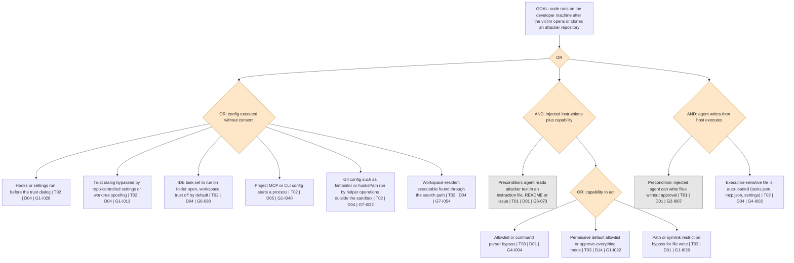
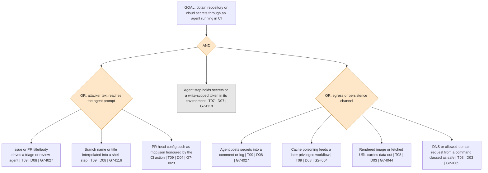
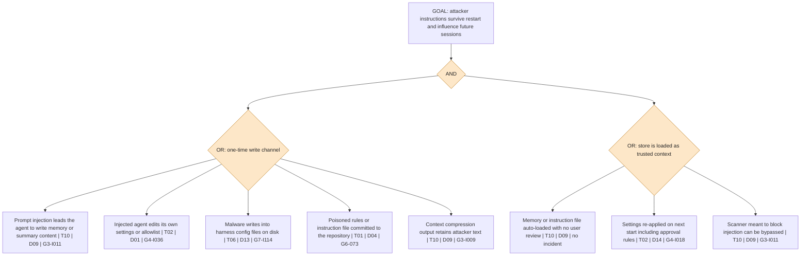
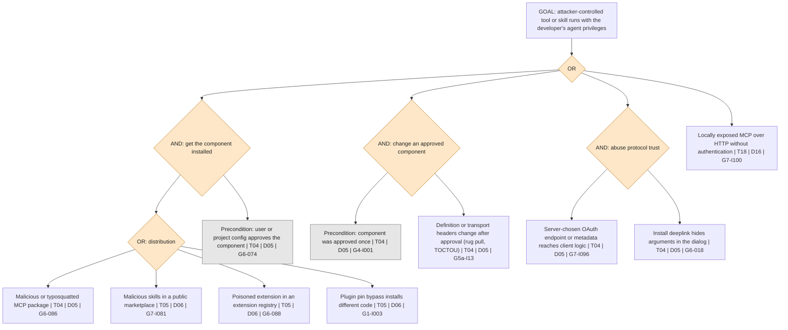
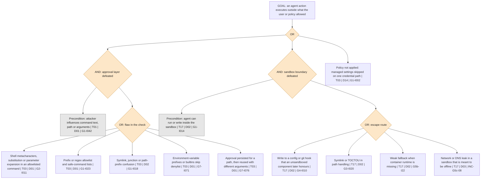
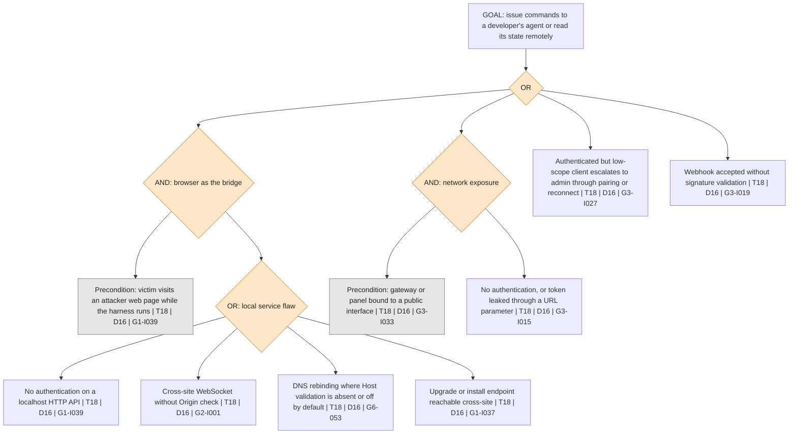
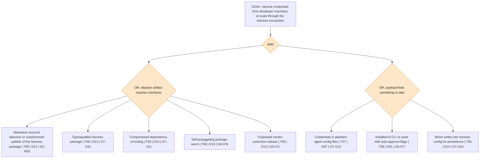

# Attack trees for AI coding-agent harnesses

Phase 2 deliverable for RQ1. Defensive level of detail only: each tree names the weakness class,
the control that mitigates it and a published incident where one exists; none contains working
exploit steps. Classes (`Txx`) are defined in `harness-threats.yaml`; controls (`Dxx`) in
`matrix/rubric.yaml` (D16 is a proposed dimension); incident ids are the `id` column of
`evidence/incidents.csv`.

## How to read the trees

- Root = attacker goal. A **diamond-shaped gate** `OR` means any one child suffices; `AND` means all
  children are required.
- Leaves (rectangles) read `weakness | class | control | example incident`. A leaf with `no incident`
  is a plausible path with no incident in the dataset.
- The class on a leaf is the weakness the leaf describes. The example's primary class in
  `incident-classification.csv` can differ, because that file records the first control that failed.
- Colour: orange = gate, grey = precondition that the attacker must satisfy, white = weakness leaf.
- Mitigating a single leaf does not remove the goal; the useful reading is the **minimum cut set**:
  for an OR root, every branch needs a control; for an AND node, one control on any child suffices.
  The cut-set notes below each tree state where controls are cheapest.

---

## Tree 1: Execute code on the developer machine through repository content

Cut set: D04 (trust gating of every config class, including git helper operations) removes branch
B1; D01 plus a sandbox (D02) reduce branches A1 and A2. Branch A2 needs both approval of writes to
execution-sensitive paths and trust gating to stop.

---

## Tree 2: Exfiltrate secrets through a headless CI agent

Cut set: because the root is an AND, the cheapest cut is removing P2 (no secrets or write token in
the agent step, D07 and D08) or restricting who can trigger the job (D08). Egress filtering (D03)
is a second independent cut.

---

## Tree 3: Persist across sessions through memory or configuration poisoning

Cut set: either break the write channel (D01 approval for writes to memory/settings, D14 managed
policy that locks permissions) or make loading conditional on review (D09 visible, project-scoped,
editable memory). Content scanners are listed as a leaf because they have been bypassed; they
should not be counted as a cut.

---

## Tree 4: Compromise through the MCP, skill or plugin supply chain

Cut set: managed allowlists for servers and plugins (D05, D06, D14) cut branches A1 and A3;
re-approval on change plus pinning cuts A2 (D05, D13). Branch L8 is outside D05 and needs D16.

---

## Tree 5: Cross the approval or sandbox boundary

Cut set: defence in depth is the only robust design: parsing-based approval (D01) fails often
(97 RC3 incidents in the dataset), so a default-on sandbox with a network allowlist (D02, D03)
and central policy (D14) should assume D01 will be bypassed.

---

## Tree 6: Take control of the agent through an exposed control plane

Cut set: requiring a per-install secret or Unix-socket transport on every local API plus Host and
Origin validation removes branches A1 and A2 together; scope subsetting rules address L6. No D01-D15
control addresses this tree, which is why D16 is proposed.

---

## Tree 7: Steal developer and agent credentials through the harness distribution chain

Cut set: this is an AND of an inbound channel and an outbound target. Registry-side controls
(2FA, trusted publishing, provenance, D13) shrink S1; local controls (keychain storage and secret
protection D07, refusing bypass flags from non-interactive callers D01/D14) shrink S2 and are
within each harness vendor's control.
